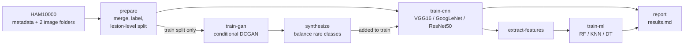

# DermaGAN: GAN-based dermatological image synthesis for skin lesion classification

[](https://github.com/yigitcangirgin/dermagan-ham10000/actions/workflows/ci.yml)
[](https://colab.research.google.com/github/yigitcangirgin/dermagan-ham10000/blob/main/notebooks/colab_quickstart.ipynb)


A conditional GAN generates synthetic dermoscopic images for the rare classes
of the [HAM10000](https://doi.org/10.1038/sdata.2018.161) dataset. These images
are then used to train skin lesion classifiers: ImageNet-pretrained **VGG16,
GoogLeNet and ResNet50** (transfer learning), plus **Random Forest, KNN and
Decision Tree** trained on CNN features.

This repository is a clean, tested re-implementation of my B.Sc. thesis
*"GAN'lar Aracılığıyla Dermatolojik Görüntü Sentezi"* (Dermatological Image
Synthesis via GANs), Software Engineering, Bandırma Onyedi Eylül University,
June 2024. Advisor: Dr. Buket Toptaş.

> **Not a medical device.** This is a research and learning project. It must not
> be used to diagnose anyone.

## Pipeline



HAM10000 classes: `akiec` actinic keratoses, `bcc` basal cell carcinoma, `bkl`
benign keratosis, `df` dermatofibroma, `mel` melanoma, `nv` melanocytic nevi,
`vasc` vascular lesions. The data is very imbalanced (about two thirds are `nv`),
which is why the GAN is used to generate extra images for the rare classes.

## Design decisions

- **Lesion-level split.** HAM10000 contains several photos of the same lesion.
  Splitting by image would put near-identical photos in both train and test and
  inflate the scores, so all images of a lesion stay in one split
  (`StratifiedGroupKFold`, 80/20 train/test, then 80/20 train/validation, as in
  the thesis).
- **Synthetic images only in training.** Validation and test sets are 100% real
  images, so the GAN can never make the evaluation look better than it is.
- **Class-balanced GAN training.** The cGAN samples every class equally often
  (`WeightedRandomSampler`); otherwise it would mostly learn `nv`.
- **Transfer learning by default.** The backbone is frozen and only the new
  7-class layer is trained (Adam, lr 0.001, batch 32, up to 20 epochs, early
  stopping on validation loss). `--finetune` trains all layers.
- **PyTorch instead of the original Keras code.** torchvision ships an
  ImageNet-pretrained GoogLeNet (Inception v1), the exact model used in the
  thesis; Keras only provides Inception v3.
- **Commands without PyTorch.** `prepare`, `train-ml` and `report` only need
  scikit-learn, and they are fully unit tested.

## Quick start

### 1. Run everything on Google Colab (free GPU)

Click the *Open in Colab* badge above and run the cells in order. The notebook
downloads HAM10000 from Kaggle, runs the whole pipeline and prints the results
table.

### 2. Run locally

```bash
git clone https://github.com/yigitcangirgin/dermagan-ham10000.git
cd dermagan-ham10000
python -m venv .venv && source .venv/bin/activate   # Windows: .venv\Scripts\activate
pip install -e ".[dev]"
```

Download HAM10000 from
[Kaggle](https://www.kaggle.com/datasets/kmader/skin-cancer-mnist-ham10000) or
[Harvard Dataverse](https://doi.org/10.7910/DVN/DBW86T) and unzip it into
`data/ham10000/` (it should contain `HAM10000_metadata.csv` and the two image
folders). Then:

```bash
dermagan prepare --data-dir data/ham10000            # -> data/splits.csv
dermagan train-gan --epochs 100                      # -> outputs/gan/generator.pt
dermagan synthesize --balance-to 1000                # -> data/synthetic/<class>/*.png

dermagan train-cnn --model resnet50                  # baseline, real images only
dermagan train-cnn --model resnet50 --synthetic data/synthetic   # + GAN images

dermagan extract-features --model googlenet --checkpoint outputs/cnn/googlenet/best.pt
dermagan train-ml --features outputs/features/googlenet.npz      # RF / KNN / DT

dermagan report                                      # -> outputs/results.md
```

Every command has `--help`. Each training run writes `metrics.json`,
`history.csv`, `history.png`, `confusion_matrix.png` and `best.pt` to its own
folder under `outputs/`.

## Metrics

Accuracy, weighted precision / recall / F1 (as reported in the thesis), plus
macro F1, mean one-vs-rest specificity and weighted ROC AUC. Macro F1 matters
here because accuracy alone looks good on HAM10000 by simply predicting `nv`.

## Results

**Reported in the 2024 thesis** (classical classifiers on GoogLeNet features,
weighted averages):

| Model | Accuracy | Recall | Precision | F1 |
| --- | ---: | ---: | ---: | ---: |
| Random Forest | 0.84 | 0.88 | 0.85 | 0.86 |
| K-Nearest Neighbors | 0.86 | 0.83 | 0.85 | 0.84 |
| Decision Tree | 0.85 | 0.87 | 0.87 | 0.85 |

These numbers came from the original code with a per-image split, so they are
not directly comparable to this repository, which uses the stricter
lesion-level split. Results of this implementation are produced by
`dermagan report` and will be added here after the full run.

## Project structure

```
src/dermagan/
  data.py          merge HAM10000 folders, labels, lesion-level split
  gan.py           conditional DCGAN, training loop, image synthesis
  classifiers.py   VGG16 / GoogLeNet / ResNet50 transfer learning, features
  ml.py            Random Forest, KNN, Decision Tree on CNN features
  metrics.py       accuracy, precision, recall, F1, specificity, ROC AUC
  torch_data.py    PyTorch dataset and augmentations
  report.py        collects metrics.json files into a Markdown table
  cli.py           `dermagan` command line
tests/             pytest suite with a tiny fake HAM10000 folder
notebooks/         Colab notebook for the full pipeline
docs/              thesis notes (Turkish)
```

## Tests

```bash
pytest          # PyTorch tests are skipped automatically if torch is missing
ruff check .
```

GitHub Actions runs ruff and the full test suite (including the PyTorch smoke
tests on CPU) on every push.

## Limitations

- The cGAN produces 64x64 images, which are upscaled to 224x224 for the CNNs,
  so synthetic images are blurrier than real ones.
- HAM10000 comes from a limited set of clinics and skin types; results may not
  generalise to other populations.
- No hyperparameter search was done; the thesis settings are used as defaults.

## Data license and citation

HAM10000 is published under a non-commercial license (see the
[Dataverse page](https://doi.org/10.7910/DVN/DBW86T)). The images are not
included in this repository. If you use the data, cite:

> Tschandl, P., Rosendahl, C., & Kittler, H. (2018). The HAM10000 dataset, a
> large collection of multi-source dermatoscopic images of common pigmented skin
> lesions. *Scientific Data, 5*, 180161.

## About

Yiğit Can Girgin, Python backend and ML developer.
[LinkedIn](https://www.linkedin.com/in/yigitcangirgin/) ·
[GitHub](https://github.com/yigitcangirgin)

I re-wrote the thesis code as a clean, tested Python package in 2026, using
Claude as a pair-programming assistant and reviewing every part of the code.
The code is released under the MIT license.

### Türkçe özet

Bu depo, Bandırma Onyedi Eylül Üniversitesi Yazılım Mühendisliği lisans bitirme
projemin (Haziran 2024) temiz ve test edilmiş bir yeniden uygulamasıdır.
HAM10000 veri setindeki az görülen cilt lezyonu sınıfları için koşullu GAN ile
sentetik görüntü üretilir. Ardından VGG16, GoogLeNet ve ResNet50 ile transfer
öğrenme, CNN özellikleri üzerinde de Random Forest, KNN ve Karar Ağacı
sınıflandırması yapılır. Ayrıntılar için [docs/TEZ_NOTLARI.md](docs/TEZ_NOTLARI.md).
